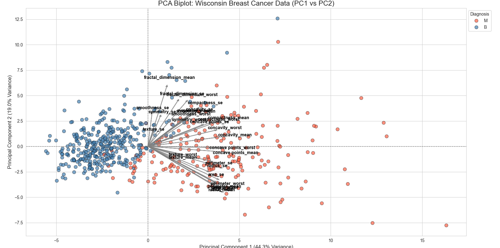
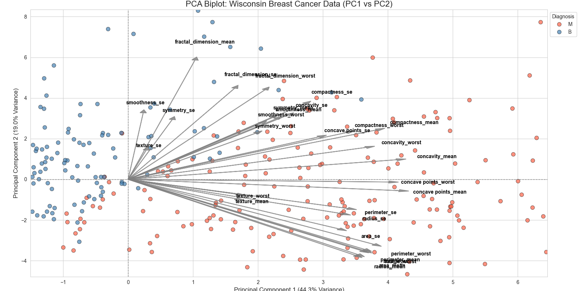

# PCA - Wisconsin Breast Cancer Dataset

A beginner-level project exploring Principal Component Analysis (PCA) using the Wisconsin Breast Cancer dataset.

## Project Overview

The goal is to reduce the dimensionality of the dataset and explore how the original features contribute to the principal components.

## Methods

- Data standardization using StandardScaler
- PCA using Scikit-learn
- Explained variance and cumulative explained variance analysis
- Selection of principal components based on 90% cumulative explained variance
- Calculation of PCA scores and loadings
- PCA biplot for visualizing observations and feature contributions

## Libraries

- Python
- Pandas
- NumPy
- Matplotlib
- Seaborn
- Scikit-learn

## Files

- `pca_analysis.py`: Main Python script
- `cancer.csv`: Dataset

## Visualizations

### PCA Biplot

### PCA Biplot (Alternative Visualization)

